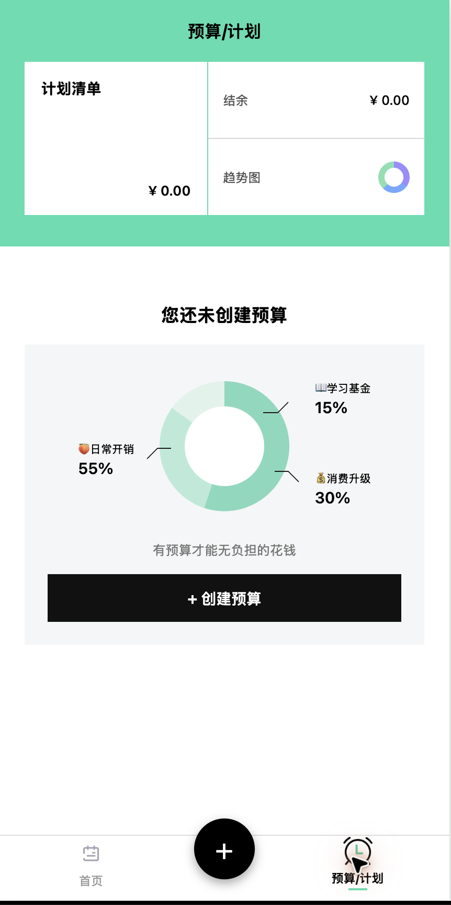
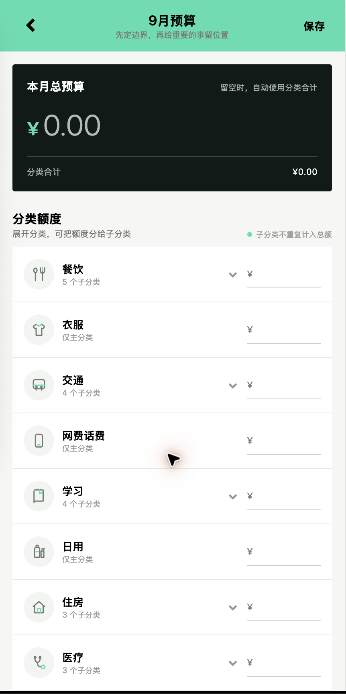

# First-entry and budget-flow audit

Date: 2026-09-18

## Post-audit corrections — 2026-09-19

- Home now opens with the calendar expanded, uses `MON` through `SUN`, shows leading and trailing
  adjacent-month dates, renders the extracted `icon_emptybox`, uses the original
  `本月还没有收支记录` copy, and removes the added unfiltered `记第一笔` button.
- The Budget empty state now uses the extracted `icon_budget_progress` artwork rather than a
  reconstructed donut. The other supplied budget/plan artwork is preserved under
  `assets/images/budget/` for the remaining flow work.
- The original budget/plan creation screens and model are still not source-identical. The supplied
  App Store executable is encrypted (`LC_ENCRYPTION_INFO_64`, `cryptid 1`), so its Swift source and
  view hierarchy cannot be recovered from the `.app`/`.ipa`; screenshots or a screen recording of
  those interactive pages remain the reliable visual source for a pixel-exact recreation.

## Scope

Combined UI, UX, state, and implementation audit of:

1. Native launch/loading behavior
2. First-entry Home empty state
3. Budget empty state
4. `+ 创建预算`
5. Expanded budget-category editing
6. Loading, read, insert/write, success, and error coverage

The reference target is the user-provided RichNote 1.1.0 app, screenshots, asset catalog, and iMazing backup. The runnable target is the local web preview at `http://127.0.0.1:4173/`.

## Overall verdict

The replica is not yet complete enough to call state-for-state faithful.

- The launch artwork exists and startup is correctly held until fonts and the database are ready, but launch styling and startup-failure recovery are incomplete.
- The first-entry Home state is visibly wrong compared with the supplied screenshot.
- The Budget empty screen is the closest copied screen.
- The `创建预算` implementation is a functional replacement, not a copy of the original budget/plan model or its screens.
- Loading and error states exist on several secondary screens, but the Home and new-transaction read paths can silently look empty when a read fails.

## Step 1 — First-entry Home reference

Health: Reference target

Reference image kept off-repo (contains private data): `~/Desktop/RICH-reference/removed-from-git/audit/00-reference-home.png`.

Target characteristics:

- Calendar expanded on entry
- English weekday labels (`MON` through `SUN`)
- Previous- and next-month filler dates
- Exact empty-box illustration
- Copy: `本月还没有收支记录`
- No extra `记第一笔` button in the empty body

## Step 2 — Current Home, expanded

Health: Poor fidelity

Differences:

- Calendar defaults to collapsed, so this is not the first state users see.
- Weekdays are Chinese numerals rather than the original English labels.
- Leading previous-month dates are blank instead of visible in a muted style.
- The original `icon_emptybox` asset is missing from the repo/UI.
- Copy is shortened to `本月还没有记录`.
- A new black `记第一笔` CTA was added even though it is absent from the supplied original state.

## Step 3 — Budget empty state

Health: Fair; visually close, behavior and semantics incomplete

Strengths:

- Main hierarchy, green header, summary block, headline, example donut, tagline, CTA, and tabs broadly match the original `01-budget-empty.png` (off-repo).
- The screen has explicit loading, error, retry, ready, empty, and populated branches.

Risks:

- The example donut is redrawn rather than using the exact original `icon_budget_progress` asset, so proportions, label placement, and color are not exact.
- `+ 创建预算`, `计划清单`, and `趋势图` are clickable but were not exposed as buttons in the captured accessibility tree.

## Step 4 — Current `创建预算`

Health: Functional, not faithful

The current screen provides a total amount and per-category/per-subcategory limits. It has validation, an explicit load/error/retry state, a disabled/saving state, transactional writes, and a visible error alert.

However, the original RichNote data model in the provided backup is materially different:

- Original `budget`: `type`, `name`, `icon`, `desc`, `state`, `record_cycle`, `cycle_money`, `first_cycle_money`, archive/order fields
- Separate original models: `deposit_plan`, `accumulate_plan`, `plan_item`, and `budget_log`
- Original bundle assets include `icon_month_budget`, `icon_special_budget`, `icon_budget_create`, four budget-help screens, four plan-help screens, `icon_no_plan`, progress controls, and plan completion artwork

The current replica instead stores one budget per month plus category/subcategory limits. It does not yet copy the original named-envelope creation flow, budget type selection, name/icon/description, recurrence/cycle setup, special budget, savings/accumulation plan, plan items, archive/reorder states, or original help/onboarding pages.

## Step 5 — Expanded category allocation

Health: Good internal behavior; wrong source model

The hierarchy is understandable and inputs are labeled. The allocation math avoids double-counting child limits. This is useful product work, but it belongs to the replacement model rather than the original RichNote flow.

## State coverage

| Area | Loading/read | Empty | Insert/write | Success | Error/retry | Verdict |
|---|---|---|---|---|---|---|
| App startup | Native splash held through font + DB initialization | N/A | Migration/seed runs | Splash hides | DB failure is thrown; no branded retry | Partial |
| Home | No visible loading state | Present, but wrong design/copy | N/A | N/A | Read failure is console-only and can look like empty data | Missing critical distinction |
| New transaction | Choices load without visible loading state | Categories/account can appear blank | Confirm disabled while saving; error alert | Returns to Home | Choice-read failure is console-only | Partial |
| Budget summary | Explicit loading state | Present | N/A | Ready/populated state | Explicit error + retry | Good state coverage |
| Budget editor | Explicit loading state | Empty inputs | `保存中`, disabled save, transaction, validation | Returns to Budget | Explicit load retry and save alert | Good behavior, wrong original model |
| Accounts / all transactions / trends | Explicit loading and error states on major views | Present | Per-action saving/alerts | Refreshes | Retry available on primary read failures | Generally good |
| CSV import/export | Busy label | N/A | Import/export operations disabled while busy | Completion alert/share sheet | Error alert | Functional; not assessed for original visual fidelity |

## Accessibility risks

- Budget-screen clickable areas lack button semantics in the captured accessibility tree.
- Small `#777777` text on `#3FDEAE` is approximately `2.62:1`, below WCAG AA for normal text.
- The screenshot audit cannot confirm VoiceOver focus order, native keyboard focus, announcement of state changes, or the compiled native splash transition.

## Highest-impact correction order

1. Restore the exact first-entry Home empty state and use the extracted `icon_emptybox` asset.
2. Match the native launch screen background/layout and add a recoverable startup-error state.
3. Replace the current budget editor/data model with the original budget/plan concepts and recreate every creation/help/empty/populated/archive state.
4. Make Home and transaction-choice loading failures visible and distinguish them from genuinely empty data.
5. Add button semantics/labels and correct small-text contrast.

## Evidence limits

- The local web preview cannot show the compiled iOS launch screen.
- The provided packaged iOS app could not be launched as a macOS application, so original creation pages were not captured interactively.
- Findings about the original budget creation flow are implementation evidence from the provided app's asset catalog and iMazing SQLite schema, not a screenshot audit of those pages.
